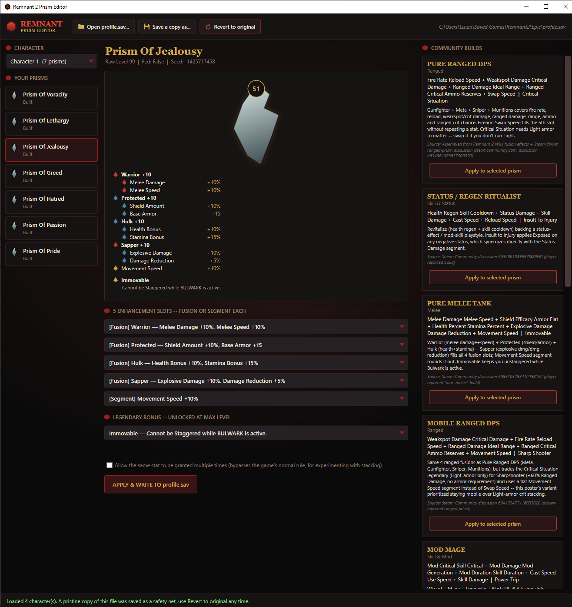

# Remnant 2 Prism Editor

A Windows desktop app for viewing and configuring the Prisms in your
**Remnant 2** save file. Pick any real fusion, segment, or legendary bonus
combination for each of your prisms, apply it, and it writes directly into
your `profile.sav`. It makes an automatic backup the first time you ever
open a file, so you can always revert.

This is a fan-made, unofficial tool. It is not affiliated with Gunfire
Games, Arc Games, or THQ Nordic. See [LICENSE.md](LICENSE.md): this is
source-available, personal-use software, not open source in the licensing
sense (no redistribution).



## 📥 Download

**[⬇ Download PrismEditor.zip (latest release)](https://github.com/lisiensemanjaku/remnant2-prism-editor/releases/latest)**

No installation needed. Unzip it anywhere and run `PrismEditor.exe`.

> Windows may show a "Windows protected your PC" SmartScreen warning the
> first time, since the exe isn't code-signed. Click **More info → Run
> anyway**. The source code in this repo is exactly what that exe is built
> from, so build it yourself with the instructions below if you'd rather
> not trust a downloaded binary.

## What it does

- Reads your prisms (Hatred, Lethargy, Passion, Pride, Jealousy, Voracity,
  Greed) straight out of `profile.sav`.
- **Works on every character in the save.** Saves can hold several
  characters, each with their own prisms. A character picker at the top of
  the left column lists them all (with a prism count for each), and editing
  one character never touches the others.
- Lets you pick any of the game's 23 real Fusions, 45 Segments, and 42
  Legendary Bonuses for each prism's 6 slots, pulled live from the game's
  own item database instead of a hardcoded list that can go stale after a
  patch.
- Shows the real numeric value each stat grants (e.g. "+10%"), read from the
  game's own data, in both the dropdown menus and the build preview.
- Checks the game's actual rules before writing anything: no stat can be
  granted twice, and a prism can't exceed 4 Fusions among its 5 enhancement
  slots. There's an optional override checkbox if you want to experiment
  with breaking those rules anyway (e.g. to see whether a stat actually
  double-stacks in-game).
- Ships 10 ready-made community prism builds (Ranged DPS, Melee Tank, Mod
  Mage, Support, and more) you can apply with one click. Each one is sourced
  or clearly marked as assembled from the game's own data.
- **Revert to original**: the very first time you open a `profile.sav`, the
  app silently saves a pristine copy next to it. One button restores it, any
  time, discarding every change, so you never have to remember to back it
  up yourself.

## How to use it

1. **Close Remnant 2** if it's running.
2. Launch `PrismEditor.exe`.
3. Click **Open profile.sav...** and pick your save file. It's usually at:
   - Epic Games: `%USERPROFILE%\Saved Games\Remnant2\<platform>\profile.sav`
   - Steam: `%LocalAppData%\Remnant2\Saved\SaveGames\profile.sav`
4. Choose a character from the **Character** dropdown (if your save has
   more than one), then pick a prism from the list below it.
5. Either:
   - Pick a fusion/segment for each of the 5 enhancement slots and a
     legendary bonus yourself, or
   - Open the **Community Builds** panel on the right and click **Apply to
     selected prism** on one you like.
6. Click **Apply & write to profile.sav**. Confirm the warning: it writes
   directly to your real save file, with an automatic backup made alongside
   it.
7. Launch the game and check it.

If anything looks wrong, click **Revert to original** to restore the file
exactly as it was the first time you opened it in this app.

### Experimenting with duplicate stats

By default the app won't let you grant the same stat twice, or use more
than 4 fusions, because the real game doesn't allow either. Check **"Allow
the same stat to be granted multiple times"** to override that and build
configurations the game's own UI wouldn't normally let you create. Useful
for testing whether a stat actually stacks when duplicated.

## Building from source

Requires the [.NET 8 SDK](https://dotnet.microsoft.com/download/dotnet/8.0).

```powershell
git clone https://github.com/lisiensemanjaku/remnant2-prism-editor.git
cd remnant2-prism-editor/PrismEditor/PrismEditor
dotnet build -c Release
```

The built exe lands at `bin\Release\net8.0-windows\PrismEditor.exe`.

To run it straight from source instead:

```powershell
dotnet run
```

## How it works, technically

Remnant 2's `profile.sav` is a compressed Unreal Engine save-game format.
This app is built on two community libraries that parse that format:
[`lib.remnant2.saves`](https://www.nuget.org/packages/lib.remnant2.saves)
and [`lib.remnant2.analyzer`](https://www.nuget.org/packages/lib.remnant2.analyzer).
Prism data lives in a nested per-character sub-archive inside `profile.sav`
itself. Nothing here touches `save_0.sav` / `save_1.sav`. The real fusion,
segment, and legendary-bonus catalog (including their numeric values and
in-game colors) is read live from the game's own bundled item database via
those libraries, not hardcoded, so it should keep working across game
patches that don't change the save format itself.

## Disclaimer

Editing your save file is something the game's own developers have
historically been tolerant of for single-player/co-op content like this
(Remnant 2 has no anti-cheat and mod support is accepted by the devs for
this kind of use). That said, **this directly edits your real save file.**
Always keep your own backup in addition to the app's automatic one, and use
it at your own risk.
